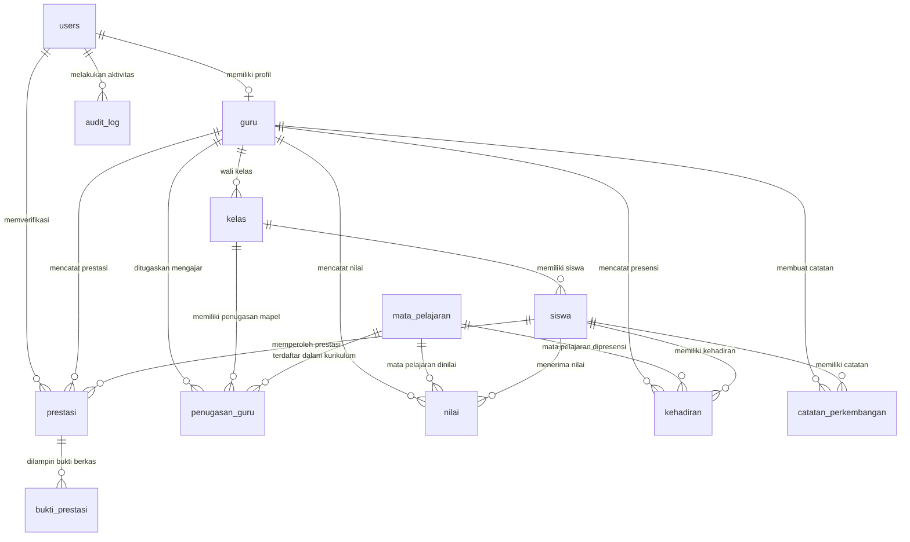

# Panduan Database PostgreSQL Sistem Manajemen Data Akademik Siswa (SIMPATIK)

Dokumentasi lengkap perancangan, migrasi, pengisian data dummy, verifikasi, dan manajemen basis data PostgreSQL untuk sistem SIMPATIK.

---

## 1. Diagram Relasi Entitas (ERD)



---

## 2. Struktur Direktori Database

```
be/
  database/
    migrations/
      V001__extensions_and_enums.sql       # Ekstensi pgcrypto, citext, pg_trgm & 8 tipe ENUM
      V002__tables.sql                     # 13 tabel inti lengkap dengan UUID, relasi, dan CHECK
      V003__indexes.sql                    # Index B-Tree, partial index, dan GIN pg_trgm
      V004__functions_triggers_views.sql   # Trigger updated_at, audit log, validasi & 5 analytical view
      V005__grants.sql                     # Hak akses DML simpatik_app (audit_log append-only)
    seeds/
      001_dummy_data.sql                   # Seed SQL idempoten (ON CONFLICT DO NOTHING)
      002_import_csv.sql                   # Script import format CSV via \copy
      csv/                                 # 12 file CSV siap pakai per tabel
        users.csv, guru.csv, kelas.csv, mata_pelajaran.csv, penugasan_guru.csv,
        siswa.csv, nilai.csv, kehadiran.csv, prestasi.csv, bukti_prestasi.csv,
        catatan_perkembangan.csv, pengaturan_sistem.csv
    scripts/
      00_setup_role_dan_database.sql       # Pembuatan role simpatik_admin, simpatik_app & db
      reset_dev.sql                        # Truncate dan re-seed (hanya db development)
      verifikasi.sql                       # Pemeriksaan kuantitas data & validasi aturan bisnis
    README.md                              # Panduan lengkap instalasi, pgAdmin, & verifikasi
```

---

## 3. Daftar Tabel & View

### 3.1 Tabel Inti (13 Tabel)
1. **`users`**: Akun pengguna sistem (Admin & Guru), email `CITEXT UNIQUE`, password hash bcrypt.
2. **`guru`**: Data guru dengan NIP unik, nomor telepon, alamat, dan soft delete.
3. **`kelas`**: Data rombongan belajar (tingkat 1–12), tahun ajaran (`YYYY/YYYY`), wali kelas.
4. **`mata_pelajaran`**: Master mata pelajaran dan kode unik.
5. **`penugasan_guru`**: Relasi penugasan guru mengajar kelas dan mapel tertentu.
6. **`siswa`**: Data peserta didik, NIS unik, jenis kelamin, tanggal lahir, dan status soft delete.
7. **`nilai`**: Nilai akademik siswa per mapel, periode, jenis nilai (HARIAN, TUGAS, UTS, UAS), dan pertemuan (0–100).
8. **`kehadiran`**: Presensi siswa per mata pelajaran dan tanggal (HADIR, SAKIT, IZIN, ALPA).
9. **`prestasi`**: Rekam jejak prestasi siswa, bidang, tingkat kejuaraan, dan status verifikasi.
10. **`bukti_prestasi`**: Berkas lampiran sertifikat/piagam (PDF, JPEG, PNG, maks 5 MB).
11. **`catatan_perkembangan`**: Catatan konseling/perkembangan siswa multi-aspek (Akademik, Karakter, Sosial, dll.).
12. **`pengaturan_sistem`**: Konfigurasi nilai ambang batas sistem (`ATTENDANCE_THRESHOLD`, `NILAI_DROP_THRESHOLD`).
13. **`audit_log`**: Catatan riwayat forensik INSERT, UPDATE, DELETE (JSONB data sebelum & sesudah).

### 3.2 Analytical Views (5 Views)
1. **`v_siswa_aktif`**: Menampilkan daftar siswa aktif (`deleted_at IS NULL`) beserta kelas dan nama wali kelas.
2. **`v_rata_rata_nilai_siswa`**: Rekap rata-rata, nilai min, dan nilai maks per siswa, per mapel, dan per periode.
3. **`v_persentase_kehadiran`**: Persentase kehadiran murni per siswa per mapel (`COUNT(HADIR) / TOTAL * 100`).
4. **`v_siswa_kehadiran_rendah`**: Deteksi otomatis siswa yang persentase kehadirannya berada di bawah ambang batas (`ATTENDANCE_THRESHOLD = 75%`).
5. **`v_ringkasan_prestasi`**: Ringkasan jumlah prestasi dikelompokkan berdasarkan status verifikasi dan tingkatan.

---

## 4. Akun Contoh (Data Dummy)

> **Catatan Keamanan:** Password baku akun contoh pada data seed adalah `password123`. Nilai yang disimpan dalam kolom `password_hash` adalah hash bcrypt valid.

| Peran | Nama | Email | Password Awal | Keterangan |
|---|---|---|---|---|
| **Admin** | Administrator Utama | `admin@simpatik.test` | `password123` | Hak verifikasi prestasi & administrasi |
| **Guru** | Bambang Sudarmanto, M.Pd. | `bambang@simpatik.test` | `password123` | Wali Kelas X IPA 1 & Guru Matematika |
| **Guru** | Siti Rahmawati, S.Si. | `siti.rahmawati@simpatik.test` | `password123` | Wali Kelas X IPA 2 & Guru Fisika/Kimia |
| **Guru** | Ahmad Fauzi, S.Pd. | `ahmad.fauzi@simpatik.test` | `password123` | Wali Kelas X IPS 1 & Guru Bhs Indonesia/Inggris |
| **Guru** | Dewi Lestari, M.Si. | `dewi.lestari@simpatik.test` | `password123` | Wali Kelas XI IPA 1 & Guru Biologi |
| **Guru** | Eko Prasetyo, S.Pd. | `eko.prasetyo@simpatik.test` | `password123` | Wali Kelas XI IPS 1 & Guru Sejarah/Ekonomi |

---

## 5. Panduan Instalasi & Eksekusi

### Opsi A: Menggunakan Command Line (`psql`)

Pastikan PostgreSQL sudah berjalan. Buka terminal (PowerShell atau Bash) pada direktori `be/database/`:

```bash
# 1. Setup Role dan Database (Jalankan sebagai user postgres)
# Ganti password pada script atau kirim argumen sesuai kebutuhan
psql -U postgres -f scripts/00_setup_role_dan_database.sql

# 2. Jalankan Migrasi DDL V001 - V005 (Menggunakan role simpatik_admin)
psql -U simpatik_admin -d simpatik_db -f migrations/V001__extensions_and_enums.sql
psql -U simpatik_admin -d simpatik_db -f migrations/V002__tables.sql
psql -U simpatik_admin -d simpatik_db -f migrations/V003__indexes.sql
psql -U simpatik_admin -d simpatik_db -f migrations/V004__functions_triggers_views.sql
psql -U simpatik_admin -d simpatik_db -f migrations/V005__grants.sql

# 3. Jalankan Pengisian Data Dummy (Seed)
# Pilihan 1: Via SQL Seed
psql -U simpatik_admin -d simpatik_db -f seeds/001_dummy_data.sql

# Pilihan 2: Via Import CSV
psql -U simpatik_admin -d simpatik_db -f seeds/002_import_csv.sql

# 4. Jalankan Verifikasi Integritas Data
psql -U simpatik_admin -d simpatik_db -f scripts/verifikasi.sql
```

---

### Opsi B: Menggunakan pgAdmin 4 (GUI)

#### Langkah 1: Mendaftarkan Server di pgAdmin
1. Buka aplikasi **pgAdmin 4**.
2. Klik kanan menu **Servers** $\to$ **Register** $\to$ **Server...**
3. Di tab **General**, isi nama koneksi: `SIMPATIK Localhost`.
4. Di tab **Connection**:
   - **Host name/address:** `localhost`
   - **Port:** `5432`
   - **Maintenance database:** `simpatik_db`
   - **Username:** `simpatik_admin`
   - **Password:** Masukkan password `simpatik_admin` yang diset saat menjalankan script setup.
5. Klik **Save**.

#### Langkah 2: Menjalankan Migrasi & Seed dari Query Tool
1. Pada pohon objek di sebelah kiri, klik database `simpatik_db`.
2. Klik menu **Tools** $\to$ **Query Tool** (atau ikon terminal query).
3. Klik ikon **Open File** (folder), buka file-file migrasi secara berurutan:
   - `be/database/migrations/V001__extensions_and_enums.sql` $\to$ tekan **Execute/Refresh (F5)**.
   - `be/database/migrations/V002__tables.sql` $\to$ tekan **F5**.
   - `be/database/migrations/V003__indexes.sql` $\to$ tekan **F5**.
   - `be/database/migrations/V004__functions_triggers_views.sql` $\to$ tekan **F5**.
   - `be/database/migrations/V005__grants.sql` $\to$ tekan **F5**.
   - `be/database/seeds/001_dummy_data.sql` $\to$ tekan **F5**.

#### Langkah 3: Verifikasi Objek Tabel dan View
1. Buka pohon navigasi: **Servers $\to$ SIMPATIK Localhost $\to$ Databases $\to$ simpatik_db $\to$ Schemas $\to$ public**.
2. Klik cabang **Tables**: pastikan terdapat **13 tabel**.
3. Klik cabang **Views**: pastikan terdapat **5 view**.

#### Langkah 4: Menjalankan Script Verifikasi
1. Di Query Tool, buka file `be/database/scripts/verifikasi.sql`.
2. Tekan **F5** untuk mengeksekusi.
3. Di panel **Data Output**, periksa hasil pengujian:
   - Jumlah admin = 1, guru = 5, siswa aktif = 58, soft-deleted = 2.
   - Semua pengujian validasi integritas bernilai **LULUS**.

#### Langkah 5: Melihat ERD (Entity Relationship Diagram)
1. Klik kanan pada schema `public` di pohon objek pgAdmin.
2. Pilih menu **Generate ERD** (atau **ERD for Schema**).
3. Diagram relasi tabel akan ditampilkan secara otomatis.

#### Langkah 6: Menguji Pembatasan Hak Akses `simpatik_app`
1. Daftarkan server baru atau ubah koneksi Query Tool dengan user `simpatik_app`.
2. Coba jalankan perintah berikut:
   ```sql
   -- Pengujian 1: Membaca audit_log (DIIZINKAN)
   SELECT * FROM audit_log LIMIT 5;

   -- Pengujian 2: Menghapus data audit_log (HARUS DITOLAK)
   DELETE FROM audit_log;
   -- Output yang diharapkan: ERROR: permission denied for table audit_log
   ```

#### Langkah 7: Import Data via Menu Import/Export CSV pgAdmin
Jika ingin mengisi data langsung dari file CSV per tabel:
1. Klik kanan tabel yang ingin diisi (misal: `users`).
2. Pilih menu **Import/Export Data...**
3. Atur tombol geser ke **Import**.
4. Di kolom **Filename**, pilih file CSV yang bersangkutan (misal: `be/database/seeds/csv/users.csv`).
5. Pada tab **Options**:
   - **Format:** `csv`
   - **Header:** Aktifkan (Yes)
   - **Delimiter:** `,` (koma)
   - **Quote:** `"`
6. Klik **OK** untuk memuat data.

#### Langkah 8: Backup dan Restore Database di pgAdmin
1. **Backup Database:**
   - Klik kanan database `simpatik_db` $\to$ pilih **Backup...**
   - **General:** Tentukan nama file cadangan, misal `simpatik_backup_2026.backup`.
   - **Format:** Pilih **Custom** (`.backup`).
   - Klik tombol **Backup**.
2. **Restore Database:**
   - Jika ingin memulihkan, buat database kosong baru atau reset database yang ada.
   - Klik kanan database $\to$ pilih **Restore...**
   - Pilih file `simpatik_backup_2026.backup`.
   - Klik tombol **Restore**.

---

## 6. Penjelasan Indeks & Cara Pengujian `EXPLAIN ANALYZE`

| Nama Indeks | Tabel / Kolom | Alasan & Kasus Penggunaan |
|---|---|---|
| `idx_siswa_kelas_id_active` | `siswa(kelas_id) WHERE deleted_at IS NULL` | **Partial Index**: Mempercepat pemfilteran siswa per kelas tanpa menelusuri baris yang sudah dihapus. |
| `idx_siswa_nama_trgm` | `siswa USING gin (nama gin_trgm_ops)` | **GIN Trigram Index**: Mempercepat pencarian nama siswa dengan substring `ILIKE '%adit%'`. |
| `idx_guru_nama_trgm` | `guru USING gin (nama gin_trgm_ops)` | **GIN Trigram Index**: Mempercepat pencarian nama guru di pencarian global. |
| `idx_nilai_siswa_mapel_periode` | `nilai(siswa_id, mata_pelajaran_id, periode)` | **Composite Index**: Mempercepat query kompilasi nilai rapor akademik individual siswa. |
| `idx_kehadiran_siswa_tanggal` | `kehadiran(siswa_id, tanggal)` | **Composite Index**: Mempercepat rekap presensi bulanan siswa. |
| `idx_audit_log_created_at_desc` | `audit_log(created_at DESC)` | **Sorting Index**: Menampilkan audit log aktivitas terbaru secara instan. |

### Cara Menguji Performa Indeks di pgAdmin (Query Tool)
Ketik query berikut dan tekan **Explain Analyze** (Shift + F7):

```sql
-- Uji Index Trigram Pencarian Nama
EXPLAIN ANALYZE
SELECT * FROM siswa WHERE nama ILIKE '%Bagas%';

-- Uji Index Rapor Nilai
EXPLAIN ANALYZE
SELECT * FROM nilai
WHERE siswa_id = '50000000-0000-0000-0000-000000000001'
  AND periode = '2026-GANJIL';
```
*Hasil Explain Analyze di pgAdmin akan menunjukkan `Bitmap Index Scan on idx_siswa_nama_trgm` alih-alih `Seq Scan` lambat.*

---

## 7. Prosedur Reset Development (`reset_dev.sql`)

Untuk mengosongkan semua data dan memuat ulang seed pada lingkungan development:

```bash
psql -U simpatik_admin -d simpatik_db -f scripts/reset_dev.sql
```
Script ini memiliki proteksi keamanan ganda (`IF current_database() <> 'simpatik_db' THEN RAISE EXCEPTION ...`) untuk memastikan script tidak dapat dieksekusi secara tidak sengaja pada database selain development.

---

## 8. Integrasi Prisma ORM

### 8.1 Alur Migrasi Prisma
1. Skema Prisma didefinisikan pada `be/prisma/schema.prisma` mencakup seluruh 13 tabel dan relasinya.
2. File migrasi awal di `be/prisma/migrations/20261020000000_init/migration.sql` telah disempurnakan dengan seluruh fitur manual (CHECK constraints, GIN trigram indexes, triggers, audit log, analytical views, dan role grants).
3. Prisma Client dikonfigurasikan secara terpusat di `be/src/config/prisma.ts` dengan penanganan error terjemahan kode Prisma (`P2002`, `P2003`, `P2025`) di `be/src/utils/prismaError.ts`.

### 8.2 Cara Mengatasi Skema Drift pada Prisma
Jika terdapat modifikasi skema secara manual via pgAdmin:
1. Periksa perbedaan struktur dengan `npx prisma migrate status`.
2. Jangan langsung menerima perintah reset pada database dengan data penting.
3. Selalu sinkronkan kembali `schema.prisma` dan buat migrasi baru:
   ```bash
   npx prisma migrate dev --name deskripsi_perubahan --create-only
   ```
4. Periksa dan sesuaikan file `migration.sql` yang terbentuk sebelum menjalankan `npx prisma migrate dev`.

